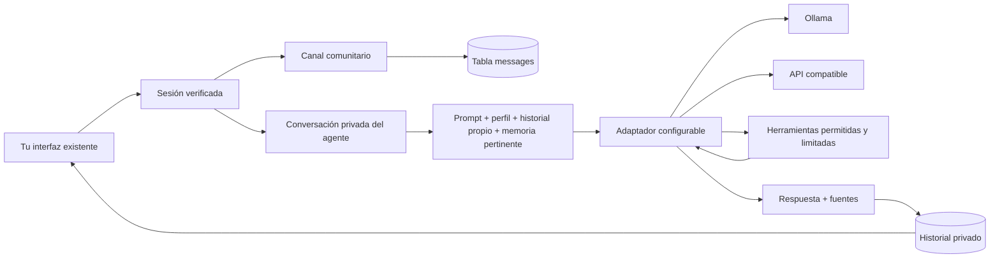

# Cómo está conectado tu agente

## Archivos y responsabilidad

| Archivo | Cambio y propósito |
| --- | --- |
| `app.py` | Conserva las rutas de login y comunidad. Añade sesiones, CSRF, validación, rutas privadas y una fábrica `create_app` para probar sin tocar tu base real. |
| `agent_core/security.py` | Hash de contraseñas y de tokens de sesión. El navegador recibe un token opaco HttpOnly; no el nombre como autorización. |
| `agent_core/storage.py` | Migra SQLite con copia previa. Separa comunidad, conversaciones, turnos, ejecuciones, sesiones y documentos. Filtra siempre las conversaciones/documentos por propietario. |
| `agent_core/config.py` | Valida los JSON, las URLs y los perfiles. Solo publica nombres y estado de configuración, sin claves ni URLs privadas. |
| `agent_core/providers.py` | Transportes HTTP Ollama y Chat Completions compatible, normalización de respuestas y diagnóstico de capacidades. |
| `agent_core/service.py` | Construye contexto, limita pasos y coordina las herramientas y la persistencia atómica del turno. |
| `agent_core/tools.py` | Registro validado de calculadora, memoria, búsqueda, grafo y scripts. Delega el código generado al ejecutor Docker. |
| `agent_core/sandbox.py` | Ejecutor Docker de Python/sh con aislamiento, límites y limpieza al cancelar. |
| `agent_core/projects.py`, `static/projects.js` | Archivos de texto privados por conversación en SQLite, copia para pruebas, vista segura y descarga ZIP. |
| `agent_core/web_reader.py`, `web_reader_worker.py` | Lector fijo de páginas en Docker con red, IP pública fijada y TLS; no habilita red al código del modelo. |
| `deploy/search/`, `scripts/setup_search.py` | SearXNG local separado y preparación de secreto/URL sin sobrescribir credenciales existentes. |
| `agent_core/relations.py` | Grafo de semejanza entre fuentes y propiedades topológicas del grafo 1D. |
| `agent_core/check.py` | Diagnóstico desde terminal sin imprimir claves. |
| `config/agent.json` | Proveedores, modelos, URL, nombre de variable de credencial y límites. |
| `profiles/*.json`, `prompts/*.md` | Tu personalización editable. Los perfiles habilitan herramientas concretas; los prompts no pueden añadir permisos. |
| `.env.example`, `.gitignore` | Plantilla de secretos del servidor y exclusión de claves, bases, registros y copias del control de versiones. |
| `static/api.js` | Carga sesión/CSRF y envía las solicitudes a tu servidor. No consulta modelos directamente. |
| `static/app.js` | Conserva el chat comunitario; pausa consultas y descarta lecturas atrasadas al entrar al agente. |
| `static/agent.js` | Conversaciones privadas, historial, perfiles, diagnóstico, memoria y presentación segura de respuestas/fuentes como texto. |
| `static/activity.js` | Acciones dentro del chat, grafo de fuentes y valoración de correcciones aprendidas. |
| `templates/login.html` | Añade registro explícito y errores del servidor al formulario existente. |
| `templates/chat.html`, `static/style.css` | Añade controles dentro del diseño actual. El logo, el video y `effects.js` se mantienen. |
| `tests/test_project.py`, `tests/test_frontend.cjs` | Pruebas de integración y de cambios de canal; límites explicados en `REVISION.md`. |
| `scripts/check_http.py` | Comprobación HTTP real sin modificar datos. |
| `scripts/check_sandbox.py`, `tests/test_laboratory.py` | Prueba Docker real y pruebas del ciclo de corrección con modelo/ejecutor simulados. |



## Configuración de proveedores y modelos propios

`default_backend` elige la opción inicial. Cada conversación conserva el identificador de proveedor y perfil; sus parámetros se leen en el servidor. Cambiar el selector crea una conversación nueva. Para añadir otro servidor, añade otra entrada en `backends`: no necesitas modificar el bucle del agente.

Ejemplo de un servidor propio con API compatible, sin autenticación, accesible solo localmente:

```json
{
  "label": "Mi modelo ajustado",
  "adapter": "openai_compatible",
  "base_url": "http://127.0.0.1:9000/v1",
  "model": "nombre-exacto-servido-por-mi-servidor",
  "api_key_env": "MI_MODELO_API_KEY",
  "require_api_key": false,
  "context_window": 8192,
  "max_output_tokens": 1024,
  "verify_tools": false,
  "output_token_field": "max_tokens",
  "system_role": "system"
}
```

Este ejemplo no inicia ni instala ese servidor. Para una API autenticada conserva `require_api_key: true` (predeterminado) y define la variable correspondiente en `.env`. Los destinos remotos requieren HTTPS. Solo se permite HTTP para localhost/loopback; las URLs no admiten contraseñas ni claves en sus parámetros. No se siguen redirecciones ni se usan proxies del entorno para estas llamadas.

El adaptador externo usa `POST /chat/completions`; `base_url` debe incluir el prefijo del proveedor, habitualmente `/v1`. Puedes ajustar `output_token_field` entre `max_tokens` y `max_completion_tokens`, y `system_role` entre `system` y `developer`. Esas opciones varían por modelo: comprueba su documentación y el diagnóstico.

Ollama usa `POST /api/chat`, historial explícito, `stream: false`, `num_ctx` y `num_predict`. Consulta `POST /api/show` para capacidades y longitud de contexto máxima. El modelo seleccionado debe declarar generación de texto o superar una consulta de comprobación. El diagnóstico externo realiza una consulta de texto; no presume herramientas, visión ni una ventana de contexto a partir del nombre del modelo. `verify_tools: true` prueba una llamada inofensiva con argumentos; una prueba negativa deshabilita las herramientas nativas. Se conserva el chat de texto y la recuperación previa de memoria.

Referencias primarias usadas para implementar los contratos: [chat de Ollama](https://docs.ollama.com/api/chat), [metadatos de Ollama](https://docs.ollama.com/api-reference/show-model-details), [Chat Completions en OpenAI Docs](https://developers.openai.com/api/reference/resources/chat/subresources/completions/methods/create). Que un servidor sea compatible con ese protocolo no garantiza todas las capacidades de otro proveedor.

## Contexto, memoria e investigación por etapas

1. **Conversación:** el servidor recibe el mensaje y una identidad de reintento. Valida sesión, CSRF, propietario y límites. Carga las instrucciones comunes y el perfil.
2. **Contexto:** recupera hasta 30 mensajes recientes en pares usuario/asistente, exclusivamente de esa conversación. Descarta pares antiguos cuando no caben; no incluye el canal general. Estima el presupuesto de forma conservadora por bytes UTF-8 más sobrecarga. No es un tokenizer exacto; el proveedor puede rechazar límites propios y el error se muestra sin guardar medio turno.
3. **Memoria documental:** busca por términos en hasta 50 textos propios. Adjunta hasta tres fragmentos pertinentes. Laboratorio también recupera hasta dos experiencias pertinentes de tu cuenta, procedentes de otros chats; los historiales permanecen separados. No hay lectura de archivos arbitrarios.
4. **Investigación opcional:** el perfil Investigador hace una búsqueda previa con la consulta del usuario y SearXNG. Añade hasta tres resultados con título, enlace y fragmento. Se muestra la lista que realmente devolvió la herramienta; el modelo recibe instrucciones de citar [n]. Las páginas no se descargan automáticamente. Las citas no son una garantía de que toda afirmación esté verificada: revisa el contenido original.
5. **Herramientas:** si el modelo declara o verifica llamadas de función, recibe solo las herramientas permitidas por el perfil. Los argumentos se validan y hay límites compartidos. El perfil Investigador necesita habilitar `web_search`; un prompt no puede otorgar una herramienta no permitida.
6. **Persistencia:** solo al terminar se guardan juntos el mensaje y la respuesta, con fuentes. En un error o vencimiento no se incorpora un turno incompleto al contexto. Un mismo `request_id` y mensaje devuelve la respuesta guardada; reutilizarlo con otro texto devuelve conflicto. Un error de red posterior a que el proveedor haya procesado una consulta puede implicar consumo sin respuesta; no hay garantía universal de idempotencia del proveedor.

El máximo configurado es 180 segundos por ejecución, 90 por solicitud al modelo, ocho llamadas al modelo y ocho herramientas (incluye la búsqueda previa). Laboratorio y Agente permiten dos correcciones y necesitan al menos 16384 de contexto; cada contenedor tiene su propio plazo de 15 segundos. Hay dos ejecuciones simultáneas para toda la aplicación y una por usuario, con reservas en SQLite. Los diagnósticos tienen su propio límite de frecuencia y tiempo. La red se cancela al vencer el plazo global. La recuperación inicial se hace antes del bucle, con tamaño acotado. El [perfil Agente](AGENTE_GRAFOS.md) añade planificación mediante DAG y argumentos estructurados en Ollama.

No se guardan claves en el historial ni se envían al modelo. No se publican cuerpos de error del proveedor. La aplicación puede aceptar texto personal en memoria, pero sus fragmentos se transmiten al proveedor seleccionado cuando son pertinentes. El canal general es compartido por diseño; la memoria y el agente son privados por cuenta.

## Prompts, memoria y pesos son cosas distintas

| Personalización | Qué cambia | Dónde se hace ahora |
| --- | --- | --- |
| Prompts/perfiles | Instrucciones, estilo y herramientas permitidas en cada consulta | `prompts/`, `profiles/`. Implementado. |
| Memoria documental / recuperación | Texto pertinente añadido al contexto; no cambia parámetros del modelo | Memoria privada de SQLite. Implementado con búsqueda léxica; embeddings son una ampliación posterior. |
| Entrenamiento o ajuste de pesos | Parámetros del modelo mediante un proceso de entrenamiento y datos preparados | No iniciado. Un modelo ajustado podrá conectarse después mediante un servidor admitido y su nombre en `config/agent.json`. |

Los prompts del proyecto son instrucciones iniciales propias que puedes sustituir. Se tomó como referencia la separación de Agent Zero entre configuración, contexto, perfiles, modelo y herramientas. El ejecutor Docker de Python es propio de este proyecto; no incorpora el entorno completo, escritorio, extensiones ni delegación de Agent Zero.

## Rutas principales

| Ruta | Uso |
| --- | --- |
| `GET /api/session` | Identidad actual y token CSRF de esa sesión. |
| `GET/POST /api/messages` | Canal comunitario conservado. |
| `GET /api/agent/config` | Perfiles y nombres públicos de proveedores, sin secretos. |
| `POST /api/agent/check` | Comprobar el modelo seleccionado; puede realizar inferencia real. |
| `GET/POST /api/agent/conversations` | Listar/crear conversaciones del usuario actual. |
| `GET/POST /api/agent/conversations/{id}/messages` | Historial propio/enviar al agente. POST exige `message` y `request_id` UUID. |
| `GET/POST /api/agent/memory` | Listar/guardar documentos propios. |
| `DELETE /api/agent/memory/{id}` | Eliminar un documento propio. |
| `POST /logout` | Cerrar y revocar la sesión con token CSRF del formulario. |
| `GET /api/agent/conversations/{id}/activity` | Última ejecución o `request_id` concreto; eventos posteriores a `after`, del propietario. |
| `GET /api/agent/conversations/{id}/project` | Archivos de texto privados de la conversación actual. |
| `GET /api/agent/conversations/{id}/project.zip` | ZIP como adjunto, sin publicar ni ejecutar el proyecto generado. |
| `GET /api/agent/lessons` | Correcciones observadas de tu cuenta. |
| `POST /api/agent/lessons/{id}/feedback` | Marcar una experiencia propia como útil o incorrecta, con CSRF. |

Todas las rutas de datos exigen sesión. Las mutaciones de API exigen además `X-CSRF-Token`. La interfaz lo obtiene del servidor y lo añade con `static/api.js`. Si se cambia de cuenta en otra pestaña, el token anterior se rechaza y se limpia la vista privada. Los errores de validación no reflejan contraseñas en las respuestas.

Las sesiones duran doce horas por defecto y se conservan en SQLite al reiniciar. HTTPS requiere `COOKIE_SECURE=true`; para otro nombre de host configura `APP_ALLOWED_HOSTS` en `.env`. La aplicación sigue siendo una base local, sin recuperación de contraseñas, verificación de correo, gestión administrativa de cuentas ni autorización de salas comunitarias múltiples.

Consulta [LABORATORIO.md](LABORATORIO.md) para el ciclo de autocorrección, estados del aprendizaje y alcance del grafo.

`project_write` y `project_read` están habilitados en Laboratorio. Las escrituras son atómicas por lote y tienen límites combinados de rutas y tamaño; no forman parte de la transacción del turno de mensajes. Una ejecución fallida puede dejar un proyecto pendiente de comprobar. Cada script de proyecto recibe una copia de los archivos, sin volúmenes del equipo; los cambios del contenedor no se capturan automáticamente. Los eventos incluyen hashes de los archivos usados para identificar la versión comprobada.

`web_search` y `web_read` están habilitados en Mi agente, Investigador y Laboratorio. Mi agente no fuerza una búsqueda inicial: el modelo decide cuándo la necesita. Investigador sí realiza una búsqueda al comenzar el turno. El código del lector es fijo y no se toma del modelo. Se limita a resultados exactos del buscador, HTTPS público en 443 y no sigue redirecciones. Valida todo el conjunto DNS y fija una dirección en la conexión, manteniendo validación TLS del nombre. Revisa robots y extrae HTML/texto acotado. Su red usa bridge con validación en el lector, no un proxy de salida general para scripts arbitrarios. Consulta [PROYECTOS.md](PROYECTOS.md) para uso y pruebas reales/simuladas y [POTENCIA.md](POTENCIA.md) para las diferencias entre orquestación, memoria y entrenamiento.

El proveedor local usa `llama3.2:3b`, contexto 16384, temperatura 0 y prueba real de herramientas. `temperature` es opcional por backend; si no se configura no se envía a la API. `normalize_arguments` adapta listas, objetos, booleanos y números que un modelo envíe como texto JSON solo cuando el esquema declara ese tipo. No evalúa código, no convierte los strings de contenido ni elimina campos desconocidos: las validaciones y permisos de Tools siguen siendo obligatorios. La prueba real se ejecuta mediante `scripts/check_agent_live.py` con SQLite temporal; consulta [CONEXION_LOCAL.md](CONEXION_LOCAL.md).
