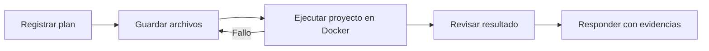

# Agente con grafos y evaluación

El equipo multiagente está activado. Los grafos de acciones y fuentes siguen aportando dependencias y evidencias; el nuevo controlador añade especialistas, trabajos persistentes y revisión. La evaluación conserva su base offline y no se ajustan los pesos de Llama.

## Usarlo

Mantén Ollama, Docker Desktop y el SearXNG local iniciados. Ejecuta la aplicación desde esta carpeta:

```powershell
.\.venv\Scripts\python.exe -X utf8 app.py
```

Si hay una instancia antigua, detenla en su terminal antes de iniciar la nueva. Abre `http://127.0.0.1:8000`, inicia sesión y entra en **Mi agente · privado**. Para conversaciones nuevas se selecciona **Equipo · investigar, ejecutar y verificar**; **Agente · planificar y ejecutar** sigue disponible. El plan y los especialistas aparecen en **Laboratorio y actividad**; los archivos guardados se pueden descargar como ZIP.

El chat programa el trabajo en segundo plano y consulta su estado cada 1,5 segundos. Puedes abrir otra conversación, conservar sus borradores y volver al resultado. La cola recupera tareas pendientes tras reiniciar; el propietario puede cancelarlas. La investigación del principal usa únicamente mensajes y fuentes públicos, sin incorporar los proyectos o documentos privados.

Ejemplo pequeño:

> Crea promedio.py y pruebas para una lista vacía y [2,4]. Guarda los archivos, ejecuta las pruebas y comunica la salida observada.

Para investigación:

> Busca documentación oficial sobre unittest, lee una fuente devuelta y explica su uso con citas.

Con el equipo habilitado, una petición de investigación usa dos enfoques, con herramientas e informes separados. Las búsquedas y lecturas pueden avanzar de dos en dos; todas las llamadas al modelo de la aplicación comparten el límite actual de una simultánea. El revisor contrasta hallazgos y el servidor valida que sus citas correspondan a extractos realmente leídos. Los fragmentos del buscador no bastan como evidencia. Para `complete` hacen falta dos fuentes distintas leídas, dos investigadores terminados y revisión válida sin errores o lagunas pendientes. Si falta evidencia, entrega `partial` o `blocked` y comunica la causa.

El equipo dispone de 600 segundos de ejecución; cada investigador tiene hasta dos búsquedas y dos lecturas de 1800 caracteres, y la investigación admite cinco llamadas al modelo. Dos trabajadores consultando una misma URL no cuentan como dos fuentes distintas. Consulta [arquitectura y límites exactos](ARQUITECTURA_MULTIAGENTE.md).

El modelo elige acciones dentro de las herramientas permitidas. El ejecutor admite Python y sh con biblioteca estándar en Docker. Las búsquedas y las lecturas públicas usan servicios separados; los scripts generados no tienen red ni acceso al proyecto anfitrión.

Las consultas que pueden resolverse con texto y las preguntas de aclaración admiten `answer` antes de crear un plan. Por ejemplo, «quiero descargar una cumbia» debe pedir el título, artista o enlace; no necesita generar ni ejecutar Python. Con un enlace concreto, `download_url` puede descargar un archivo real y preparar audio MP3. `download_tools` detecta las herramientas instaladas. `project_write` guarda texto/código y rechaza extensiones multimedia para evitar presentar texto como un MP3 o una imagen. Consulta [descargas y pruebas](DESCARGAS.md).

## Dos grafos con funciones distintas

El **grafo de acciones** es dirigido y acíclico. Un paso tiene `id`, `title`, `tool` y `depends_on`. El servidor rechaza ciclos, dependencias desconocidas y herramientas no permitidas mediante ordenación topológica. Una escritura debe tener una ejecución posterior en el plan.



La flecha de corrección del diagrama representa el controlador de reintentos. El DAG del plan mantiene las dependencias `guardar → ejecutar`; repetir el paso anterior invalida sus descendientes, sin añadir un ciclo al DAG.

El plan admite hasta cinco acciones para reservar llamadas de respuesta y revisión. Los estados son `pending`, `observed` y `failed`. Solo un resultado de herramienta cambia un paso a `observed`. El registro conserva intentos, identificadores de fuentes y manifiestos de archivos cuando existen. Un resultado observado no prueba que se haya cumplido todo el significado del título del paso.

Al terminar el plan se cierra la fase de acciones y se genera/revisa la respuesta. Así se evita que el modelo siga creando archivos o repitiendo ejecuciones innecesarias. El controlador del ejecutor permite hasta ocho pasos y ocho herramientas; los pasos de ejecución fija de pruebas no consumen una llamada al modelo. Las llamadas de los especialistas se contabilizan aparte. El Laboratorio mantiene su presupuesto de hasta dos correcciones de scripts. Un turno individual conserva 180 segundos; cuando se activa el equipo, dispone de 600 segundos. Cada script sigue limitado a 15 segundos.

Para programación y matemáticas, el equipo prepara informes de requisitos y verificación antes de ejecutar. En programación impone el plan **guardar → comprobar**. Si se solicitan pruebas Python, ejecuta las pruebas unittest guardadas y rechaza un conjunto vacío. Un revisor independiente puede pedir hasta una reparación adicional del equipo si queda presupuesto; los archivos corregidos deben ejecutarse de nuevo. La entrega queda parcial cuando persisten pasos, fallos, archivos sin probar o una revisión incierta.

La recuperación conserva la cola, las fases de investigación y los informes de especialistas en SQLite, vinculados a la petición y al contrato versionado del skill. Revalida los informes completos antes de reutilizarlos. Los proyectos, sus manifiestos y los snapshots del equipo permiten identificar qué versión se guardó y comprobó. Esto no mantiene un script suspendido ni reanuda una línea exacta del DAG: una fase incompleta puede ejecutarse otra vez. Un turno nuevo sigue teniendo su propio plan.

El **grafo de fuentes** relaciona conjuntos de términos. Para dos fuentes A y B:

```text
Jaccard(A,B) = |A ∩ B| / |A ∪ B|
β0 = número de componentes
β1 = aristas − vértices + componentes
```

Cada arista guarda `similarity_exact` como numerador/denominador reducidos, además de una aproximación decimal para presentación. El umbral se compara como fracción. Los componentes y ciclos son propiedades exactas de ese grafo finito; no validan afirmaciones ni establecen causalidad.

## Argumentos y comprobación de archivos

El perfil Agente usa el contrato JSON estructurado de Ollama. Antes de registrar el plan permite herramienta/argumentos o `answer` para responder o pedir una aclaración. Con un plan pendiente y una única herramienta lista, solicita directamente los argumentos de su esquema. Para varias herramientas usa un contrato con herramienta/argumentos; al finalizar el plan permite responder. El servidor valida nombres, permisos, dependencias y los argumentos concretos antes de ejecutar. No interpreta JSON encontrado dentro de prosa como una orden.

El presupuesto de contexto incluye las instrucciones y el contrato JSON que realmente se envían a Ollama. Si las herramientas llenan ese presupuesto, se retiran pares de historial antiguos y se resumen intercambios completos de acciones/resultados; se conservan estados, identificadores de intento y las últimas líneas de error. Las llamadas nativas y sus resultados se sustituyen juntos. Los eventos y los archivos guardados conservan sus datos originales. Una petición que no cabe incluso resumida sigue devolviendo un error explícito: los 16384 configurados no equivalen a contexto ilimitado.

La API compatible conserva sus llamadas de herramientas nativas. Esta modalidad sigue necesitando que el proveedor las produzca correctamente. El diagnóstico inicial no demuestra fiabilidad en una tarea larga.

Antes de guardar un lote, Agente comprueba la sintaxis de sus archivos `.py` con el parser de Python del servidor, sin ejecutarlos; un error rechaza todo el lote. La comprobación no valida la lógica ni las dependencias. El generador de argumentos de escritura recibe un contexto reducido con la petición y observaciones, para separar el formato de archivos del de ejecución; planificación y respuesta conservan el contexto del agente.

Una escritura marca el proyecto como pendiente de ejecución. Solo una ejecución exitosa con `project=true` registra el manifiesto SHA-256 de la copia probada en SQLite (`project_checks`). El estado se conserva entre turnos y al reiniciar; una escritura posterior lo invalida. Ejecutar código suelto no comprueba los archivos guardados. Un código de salida cero tampoco demuestra exactitud general: hacen falta aserciones o pruebas pertinentes para el objetivo.

El equipo conserva además snapshots con contenido, SHA-256 y estado de comprobación en `agent_team_checkpoints`. El revisor recibe el borrador y evidencia de archivos y ejecuciones; sus propuestas no sustituyen a las salidas de herramientas. Los contratos `research`, `coding`, `math` y `download` se validan desde `agent_skills/`. Cambiar su versión modifica el contrato de trabajo y su identidad de recuperación; no entrena el modelo.

Documentación primaria: [salidas estructuradas de Ollama](https://docs.ollama.com/capabilities/structured-outputs), [herramientas de Ollama](https://docs.ollama.com/capabilities/tool-calling) y [ordenación topológica de Python](https://docs.python.org/3/library/graphlib.html).

## Clasificación de fuentes

Antes se conservaban los tres primeros enlaces válidos. Ahora se consideran hasta veinte candidatos, se eliminan URLs equivalentes con fragmentos o parámetros de seguimiento y se clasifican por BM25 más cobertura de términos en el título. La selección prioriza como máximo dos enlaces por dominio y completa las plazas restantes si no hay alternativas.

```text
BM25(q,d) = Σ IDF(t) · tf(t,d) · (k1+1)
                       / [tf(t,d) + k1 · (1-b+b·|d|/avgdl)]
IDF(t) = ln[1 + (N-df(t)+0.5)/(df(t)+0.5)]
k1 = 1.2; b = 0.75
score = BM25 + cobertura de términos de la consulta en el título
```

No se han aprendido estos parámetros del corpus. La puntuación estima pertinencia léxica, no verdad, autoridad, actualidad ni independencia editorial. Un mismo dominio puede alojar contenidos de autores distintos; dominios distintos pueden repetir una misma noticia. El caso de palabras repetidas y el de paráfrasis muestran fallos de esta aproximación. La referencia del componente BM25 está en [la documentación de Elastic](https://www.elastic.co/guide/en/elasticsearch/reference/8.19/index-modules-similarity.html).

## Base de evaluación antes del entrenamiento

`evaluation/search_cases.json` contiene diez consultas ilustrativas: tres `train`, dos `validation` y cinco `test`. Los extractos fueron redactados como ejemplos; no son descargas de las URLs indicadas. Las etiquetas manuales van de 0 (irrelevante) a 3 (muy pertinente), con casos de ruido, paráfrasis y títulos que repiten palabras sin aportar evidencia.

```powershell
.\.venv\Scripts\python.exe -X utf8 scripts/evaluate_agent.py --split test --output evaluation/report.json
```

El informe compara el orden original de los candidatos con el clasificador mediante Precision@3, Recall@3, MRR@3 y nDCG@3. Valida identificadores, consultas duplicadas, particiones y etiquetas completas por URL. Es una evaluación offline pequeña: no demuestra mejora general en internet ni mide la exactitud de la respuesta final.

Para avanzar hacia entrenamiento:

1. Añade consultas reales representativas y los candidatos recibidos, retirando datos privados.
2. Revisa las fuentes y asigna relevancia por candidato; conserva fecha y criterio de revisión.
3. Reserva consultas y temas completos para prueba; no ajustes parámetros mirando sus resultados.
4. Usa entrenamiento para ajustar un clasificador, validación para elegir configuración y prueba para comparar con la base.
5. Considera embeddings, un reranker o LoRA después de medir errores suficientes. Un grafo o un recuerdo guardado no modifica los pesos de Llama.

Las pruebas de control del agente están en `tests/test_agent_graph.py`, las del contrato en `tests/test_structured_actions.py` y las métricas en `tests/test_retrieval.py`. La prueba real del flujo mínimo es:

```powershell
.\.venv\Scripts\python.exe -u -X utf8 scripts/check_agent_live.py --backend local --agent-graph --general-web
```

Usa SQLite temporal, no crea cuentas en la base del proyecto y no entrena modelos. Una prueba mínima aprobada no acredita autonomía general.

Para comprobar el equipo completo con el proveedor real, Docker y SearXNG:

```powershell
.\.venv\Scripts\python.exe -u -X utf8 scripts/check_team.py
.\.venv\Scripts\python.exe -u -X utf8 scripts/check_team.py --code
```

El primer comando exige al menos dos fuentes leídas y una investigación completa. El segundo exige archivos comprobados y ejecución observada de sus pruebas. Conservan informes en `.local/team-checks/research.json` y `coding.json`; usan SQLite temporal y terminan con error ante un resultado incompleto. Los roles se coordinan en este servidor; no se desplegaron otras máquinas virtuales ni se modificaron los pesos de Llama.
