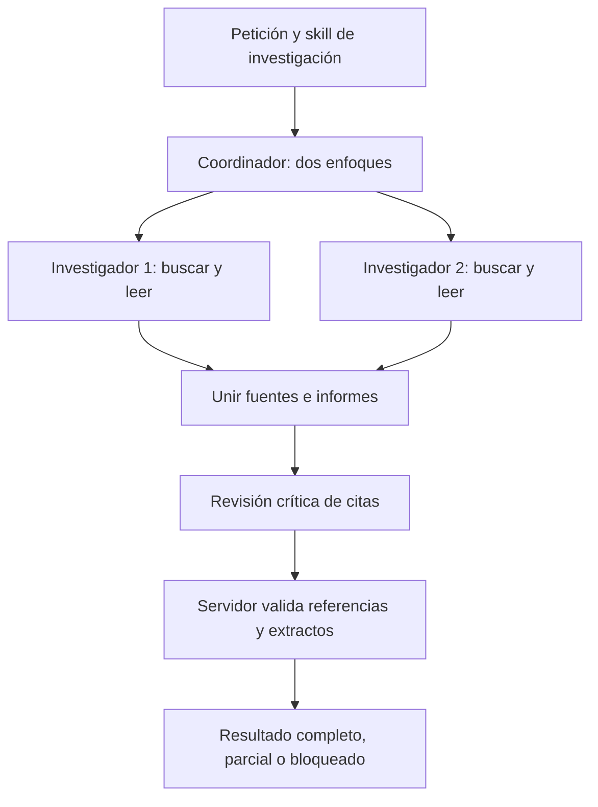

# Equipo multiagente activado

El equipo está implementado y habilitado mediante `multi_agent.enabled: true` en `config/agent.json`. **Equipo · investigar, ejecutar y verificar** es el perfil predeterminado para conversaciones nuevas. Usa el proveedor configurado; actualmente Ollama local con `llama3.2:3b`.

El servidor selecciona el procedimiento según la petición. Una investigación distribuye búsquedas y lecturas entre dos especialistas. Una tarea de programación o matemáticas incorpora especialistas de requisitos y verificación, un ejecutor y un revisor independiente. Los saludos y las aclaraciones conservan una ruta corta. Una descarga explícita con enlace pasa directamente a su cola de descargas.

Son roles coordinados por esta aplicación. Los investigadores conservan herramientas e informes separados y se comunican mediante datos estructurados del servidor. El sistema no despliega otras máquinas virtuales ni conecta equipos remotos. Docker ejecuta comprobaciones y lecturas en contenedores con permisos distintos según su función.

## Uso en la interfaz

1. Mantén Ollama, Docker Desktop y SearXNG iniciados y abre la aplicación.
2. Recarga la página, entra en **Mi agente · privado** y crea una conversación con **Equipo · investigar, ejecutar y verificar**.
3. Escribe el objetivo y los criterios que quieres comprobar.
4. Consulta **Laboratorio y actividad** para ver especialistas, fuentes, ejecuciones, revisión y errores. Los archivos aparecen en **Archivos y descargas**.

El envío devuelve enseguida un identificador de trabajo. La interfaz consulta su estado cada 1,5 segundos; puedes escribir un borrador, abrir otra conversación o volver al principal mientras el servidor trabaja. Al abrir una conversación recupera sus trabajos y resultados. **Cancelar trabajo** detiene la ejecución pendiente de esa conversación. El resultado privado siempre permanece en su conversación.

Ejemplos:

> Busca en documentación oficial para qué sirven unittest.TestCase y assertEqual. Lee fuentes distintas y explica qué respalda cada una.

> Crea promedio.py con una función promedio(valores) que devuelva el promedio y lance ValueError para una lista vacía. Guarda test_promedio.py con unittest para [] y [2,4]. Ejecuta los archivos guardados en Docker e informa del resultado.

> Resuelve 3x + 7 = 22 y comprueba el resultado por sustitución.

Pedir búsquedas explícitas activa la investigación también desde perfiles que permiten buscar y leer. Si el agente necesita buscar durante otra tarea, puede delegar esa búsqueda en el equipo y conservar sus fuentes y estado de verificación. Una petición que prohíbe usar internet mantiene las herramientas web fuera de su ámbito.

## Investigación: dos enfoques y evidencia leída



Cada investigador recibe su propio objeto de herramientas. Las búsquedas y lecturas pueden avanzar en paralelo; las llamadas al modelo comparten un semáforo, incluidos los especialistas, el ejecutor y la conversación del principal. Los enlaces del usuario son candidatos autorizados y pueden leerse aunque el buscador falle. Se admiten las páginas públicas HTTPS que puede extraer el lector fijo de Docker; no ejecuta JavaScript de la página.

Los fragmentos del buscador sirven para encontrar páginas. Solo un extracto obtenido mediante `web_read`, marcado como `page_extract`, puede respaldar una cita del equipo. El controlador comprueba que cada cita existe en el extracto observado y que su identificador corresponde a una fuente leída. Unifica URLs equivalentes y reasigna los identificadores antes del intercambio entre especialistas. El revisor recibe hallazgos y citas comprobadas; no puede crear una referencia nueva durante la síntesis.

El estado `complete` requiere dos investigadores terminados, al menos dos URLs distintas leídas, hallazgos respaldados y una revisión válida, sin contradicciones, lagunas ni errores pendientes. Si hay evidencia aprovechable pero falta alguna condición, devuelve `partial` con lo pendiente. Sin páginas leídas devuelve `blocked`. Dos investigadores que consultan la misma página no constituyen contraste entre dos fuentes distintas.

Esta comprobación acredita la correspondencia entre citas y extractos limitados. No demuestra la verdad universal de las páginas, su independencia editorial o la exactitud de toda interpretación del modelo.

## Programación y matemáticas: ejecutar y revisar

`TeamCouncil` prepara dos informes: **requisitos** y **verificación**. El ejecutor utiliza esos informes y el contrato del skill para realizar la tarea. Los especialistas proponen comprobaciones; sus informes no cuentan como pruebas ejecutadas.

En programación, el controlador registra el procedimiento **guardar → comprobar**. `project_write` conserva los archivos privados de la conversación; `sandbox_exec` ejecuta una copia en un contenedor temporal. Si la petición incluye pruebas Python o unittest, el controlador usa descubrimiento de las pruebas guardadas y rechaza un conjunto vacío. La comprobación apunta a los archivos persistidos, no a otra copia del programa pegada en el chat.

El contenedor de código generado no tiene red, credenciales ni montajes de los archivos del anfitrión. Sus límites actuales son 15 segundos, 256 MB, una CPU y 32 procesos. El lector fijo de páginas y SearXNG usan servicios separados con red. Un proyecto que necesita dependencias externas debe disponer de una imagen preparada que las incluya; las instrucciones del skill no instalan paquetes en el anfitrión.

Una ejecución correcta con `project=true` guarda el manifiesto SHA-256 en `project_checks`. Una escritura posterior invalida esa comprobación. Se conservan además snapshots del contenido, su hash y si estaba comprobado. Un código de salida cero solo acredita esa ejecución; las pruebas deben representar los requisitos del usuario.

El revisor independiente examina la petición, el borrador, los archivos, las ejecuciones y los fallos pendientes. Puede devolver `satisfied`, `needs_correction` o `uncertain`. Si encuentra un fallo concreto y queda presupuesto, permite **una reparación del equipo**, reabre la ejecución y exige volver a comprobar el proyecto. Si no se resuelve, la entrega indica comprobación pendiente y `team.status: partial`.

Para matemáticas se aplica el skill `math`: se identifican supuestos y comprobaciones pertinentes y se contrastan los resultados con las herramientas disponibles. Una prueba numérica de algunos casos no equivale a una demostración general.

## Skills versionados

Los contratos están en `agent_skills/research.json`, `coding.json`, `math.json` y `download.json`. Incluyen `id`, `version`, `purpose`, `tools`, `acceptance_criteria` y `repair_policy`. `SkillRegistry` valida el esquema y la identidad antes de usarlos. Los prompts de los especialistas se encuentran en `prompts/team_research/`; los del ejecutor se seleccionan mediante los perfiles.

El prompt orienta al modelo. El controlador decide permisos, límites, argumentos, dependencias, validez de citas y comprobación de archivos. El contrato identifica la evidencia conservada; una versión diferente no reutiliza a ciegas informes del contrato anterior.

Cambiar un skill modifica instrucciones y criterios. Guardar experiencias recuperables no cambia los pesos del modelo. No se activó entrenamiento ni actualización automática de skills a partir de las opiniones de los propios agentes.

## Cola, recuperación y aislamiento

`agent_jobs` conserva propietario, conversación, petición, identificador, estado y resultado en SQLite. Los estados son `queued`, `running`, `complete`, `failed` y `cancelled`. Reenviar el mismo identificador y texto recupera el mismo trabajo; usarlo para otro texto produce conflicto.

El servidor recupera trabajos pendientes al reiniciar. Un cierre ordenado los devuelve a la cola y conserva las fases ya persistidas. El cliente no necesita mantener abierta una petición HTTP durante toda la ejecución.

`agent_team_checkpoints` conserva planes, informes de investigadores, intercambio, revisiones y resultados. La identidad combina petición y contrato del skill. La recuperación valida los informes antes de reutilizarlos: reaprovecha un investigador completo y su evidencia válida; una fase incompleta puede repetirse. La revisión se reutiliza cuando sus investigadores conservados son válidos. Los informes de requisitos y verificación también se conservan; la revisión del ejecutor se identifica por la versión concreta de archivos, respuesta e intento.

Los archivos privados y sus manifiestos permanecen en las tablas del proyecto. Los snapshots ofrecen trazabilidad de versiones. No se conserva un proceso Docker suspendido ni se continúa en una línea exacta de un script: el controlador vuelve a entrar en el procedimiento y reutiliza lo que puede validar. Las operaciones externas incompletas pueden necesitar repetirse.

Las rutas de trabajos, actividad, fuentes y archivos privados comprueban el propietario. Cambiar de conversación o de canal detiene el sondeo de esa vista sin cancelar el trabajo del servidor. La caducidad de sesión limpia el contenido privado de la interfaz.

## Canal principal compartido

Cada mensaje nuevo recibe respuesta. Un saludo usa la ruta de texto; una petición de investigación activa los dos investigadores, la revisión y las fuentes compartidas. Su contexto procede exclusivamente de mensajes anteriores del canal público y la petición actual. No se incorporan documentos, conversaciones o proyectos privados.

El principal guarda su cola en `community_replies` y sus fases en `community_team_checkpoints`, asociadas al mensaje público. Conserva la respuesta, sus fuentes y `team_status`; los demás usuarios ven el mismo resultado. Programación, archivos, memoria y descargas privadas se utilizan desde **Mi agente**.

## Límites actuales

Valores de `config/agent.json`; aumentar concurrencia exige comprobar capacidad y reiniciar el servidor.

| Recurso | Valor actual |
|---|---:|
| Trabajos privados simultáneos | 2 globales; uno por usuario |
| Trabajos privados pendientes | 20 globales; hasta 5 por usuario |
| Tiempo del equipo | 600 segundos de ejecución, después de esperar en cola |
| Investigadores | 2, con hasta 2 operaciones de trabajadores simultáneas |
| Llamadas simultáneas al modelo de la aplicación | 1, compartida por los roles y el principal |
| Búsquedas por investigador | Hasta 2 |
| Lecturas por investigador | Hasta 2 |
| Fuentes compartidas | Hasta 6; con esta configuración pueden leerse como máximo 4 antes de quitar duplicados |
| Extracto conservado por fuente | Hasta 1800 caracteres |
| Llamadas de investigación al modelo | Hasta 5, incluyendo planificación, análisis y revisión |
| Reparaciones de revisión | Hasta 1, si queda presupuesto |
| Ejecutor de código | Hasta 8 pasos de controlador y 8 herramientas; llamadas de especialistas contabilizadas aparte |
| Script en Docker | 15 segundos; 256 MB; una CPU; 32 procesos |
| Descargas | Cola independiente: 1800 segundos y 250 MB por archivo |

El semáforo compartido evita que los roles de la aplicación saturen el modelo con peticiones simultáneas. Otros programas que utilicen Ollama no participan en ese semáforo. Más roles no garantizan menor latencia. Los límites de reparación del Laboratorio y el límite de una reparación pedida por el revisor del equipo son presupuestos distintos y ninguno permite repetir sin límite.

## Comprobar el sistema

Desde la carpeta del proyecto, con Ollama, Docker y SearXNG disponibles:

```powershell
# Investigación real: fuentes leídas, citas y revisión del equipo.
.\.venv\Scripts\python.exe -u -X utf8 scripts/check_team.py

# Programación real: archivos, pruebas unittest y ejecución de la versión guardada.
.\.venv\Scripts\python.exe -u -X utf8 scripts/check_team.py --code
```

Estas comprobaciones usan SQLite y una cuenta temporales. No publican mensajes de prueba en las conversaciones de uso diario. Conservan informes en `.local/team-checks/research.json` y `.local/team-checks/coding.json`. Terminan con error si el resultado queda incompleto; la prueba de código también exige un proyecto comprobado y la ejecución observada de las pruebas. Usan el modelo configurado: con un proveedor externo pueden consumir cuota.

Las pruebas simuladas cubren aislamiento de trabajadores, contratos, citas inventadas, recuperación, cola, cancelación y separación entre canal público y privado:

```powershell
.\.venv\Scripts\python.exe -X utf8 -m unittest discover -s tests -v
node tests/test_frontend.cjs
```

Archivos principales: `agent_core/service.py`, `team_research.py`, `team_control.py`, `agent_jobs.py` y `community.py`. Esta arquitectura aporta comprobaciones y evidencia acotadas; no garantiza autonomía general ni respuestas siempre correctas.
