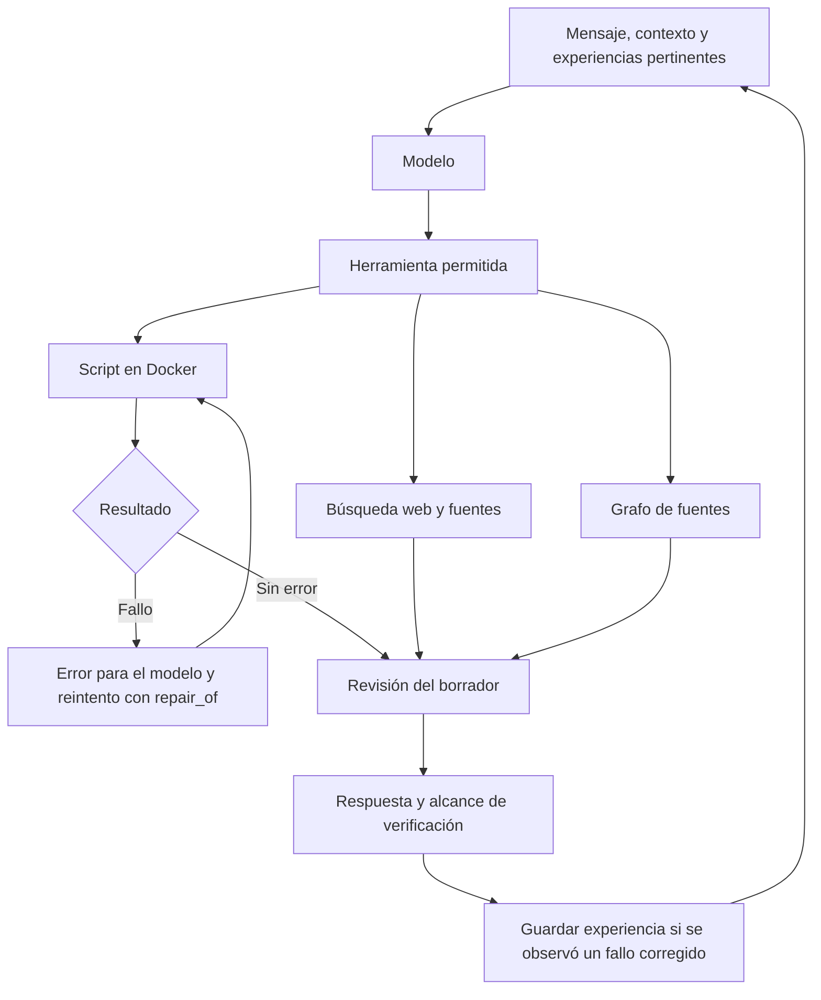

# Laboratorio: aprender de errores observados

El agente puede preparar un script, ejecutarlo, recibir su error, intentar una corrección y revisar la respuesta antes de entregarla. En el mismo chat se ve el código y el resultado de cada acción. El panel es un visor de actividad del contenedor; las tareas se piden escribiendo al agente.

## Ponerlo en marcha

1. Mantén Docker Desktop iniciado con contenedores Linux. Se comprobó su disponibilidad y se descargó la imagen oficial de Python en este equipo.
2. Ya está seleccionado `llama3.2:3b` mediante Ollama local, con prueba real de herramientas. Laboratorio requiere llamadas de herramientas y al menos **16384 de contexto**. Para cambiar de proveedor consulta [CONEXION_LOCAL.md](CONEXION_LOCAL.md) y `README.md`.
3. Para internet configura `SEARXNG_URL` en `.env`, apuntando a una instancia SearXNG con JSON. Puedes usar el buscador local preparado en `deploy/search/`: consulta [PROYECTOS.md](PROYECTOS.md). Reinicia si cambias el entorno.
4. Ejecuta el servidor, entra en Mi agente y selecciona **Laboratorio · corregir y comprobar**. Se crea una conversación privada.

```powershell
.\.venv\Scripts\python.exe -X utf8 app.py
```

Ejemplo con resultado esperado explícito:

> Este código falla para una lista vacía: `def promedio(v): return sum(v)/len(v)`. Ejecútalo con [] para comprobar el fallo. Corrígelo para devolver None si la lista está vacía. Verifica después [], [2,4] y [-2,2]. Muestra qué comprobaste.

Si el modelo usa las herramientas correctamente, verás el error, el script siguiente y sus pruebas. Si no usa una herramienta, no se inventa una ejecución. Si se agota un límite o falla un recurso, el registro muestra lo pendiente.

## Ciclo de corrección



Un reintento debe señalar el `attempt_id` fallido del mismo turno y lenguaje. Una ejecución exitosa de otro script no borra un fallo anterior. Tras el borrador se pide una revisión adicional al modelo, que puede usar más herramientas si quedan pasos. Esa revisión no equivale a una verificación independiente.

Se muestran acciones, scripts, resultados y borradores identificados como provisionales. No se solicitan ni guardan razonamientos internos extensos.

## Qué significa aprender

Se guarda una experiencia cuando hubo un fallo de ejecución identificable, un reintento asociado terminó sin error y el turno terminó sin herramientas pendientes. Se conserva el error, el script posterior y su salida, con su propietario. Se recuperan hasta dos experiencias pertinentes en futuros chats de Laboratorio del mismo usuario.

| Estado | Evidencia y uso |
| --- | --- |
| Observada | Error seguido de una ejecución sin error. Puede orientar otro intento, con esa evidencia limitada. |
| Te resultó útil | Pulsaste Me sirvió. Se prioriza al recuperar experiencias pertinentes. |
| Descartada | Pulsaste No es correcto. No se recupera como solución; se avisa al agente cuando vuelva a ser pertinente para que verifique otra solución. |

Los contadores son descriptivos: no miden precisión del modelo. Una salida cero puede acompañar un cálculo equivocado y las pruebas generadas pueden ser insuficientes. Hay que comprobar resultados esperados y casos límite. Se conservan hasta 200 experiencias por cuenta.

Los pesos no se modifican. Las experiencias permanecen en SQLite y pueden acompañar a distintos modelos configurados. Descargar un modelo, ajustar pesos y evaluar calidad son procesos separados todavía no iniciados. El agente no descarga ni ejecuta modelos o paquetes encontrados al azar en internet.

## Relaciones y topología

`research_graph` relaciona hasta ocho fuentes recuperadas en la consulta. Los nodos son fuentes y las aristas unen conjuntos de términos con semejanza de Jaccard superior al umbral, predeterminado 0.15.

- `beta_0`: componentes conectados.
- `beta_1 = aristas - vértices + componentes`: ciclos independientes.
- Densidad de conexiones y número de dominios web observados.
- Nodos y enlaces dibujados en el panel del chat.

La fórmula de ciclos cuenta las aristas que sobran al formar un árbol por componente. Se considera el grafo como un complejo de una dimensión: no se rellenan triángulos ni se calcula homología persistente. Las conexiones representan semejanza textual; no prueban causalidad, exactitud o independencia editorial.

Como decidiste definir los datos después, siguen pendientes el análisis de tablas/series, las distancias y filtraciones, la topología persistente, las pruebas de hipótesis y las métricas con un conjunto de evaluación. No se fabrican p-valores ni mejoras estadísticas a partir del grafo. La investigación se limita a fuentes y herramientas consultadas; no recorre todos los procesos posibles de internet.

## Ejecución y límites

Se usa una imagen oficial de Python fijada en `sandbox.image`. No se montan carpetas del equipo ni el socket de Docker. Los scripts reciben su código por stdin, sin las claves ni el entorno completo del servidor.

Cada contenedor tiene raíz de solo lectura, usuario 65534 sin privilegios, capacidades retiradas, red deshabilitada y `/tmp` temporal de 32 MiB. Se limita a 256 MiB de memoria, una CPU, 32 procesos, 15 segundos y 12000 bytes de salida. Se elimina al terminar, agotar límites o cancelar. No hay alternativa que ejecute código del modelo en el host. Las opciones siguen [Docker Docs](https://docs.docker.com/engine/containers/run/).

Python y sh pueden usar la biblioteca estándar y archivos temporales. Para internet el agente llama a `web_search`, que consulta SearXNG, y opcionalmente a `web_read`, un lector de código fijo en otro contenedor con red. Los contenedores que ejecutan código del modelo siguen sin red ni instalación de dependencias. Las bibliotecas adicionales requieren una imagen preparada por el administrador.

`project_write` guarda archivos privados de esta conversación en SQLite. `project_read` los lista o lee por fragmentos. `sandbox_exec` con `project=true` reconstruye una copia temporal en `/tmp/project` para comprobarlos, sin montar carpetas del equipo. El panel **Archivos del proyecto** muestra su texto y permite descargar un ZIP. Hasta 32 archivos, 16000 bytes por archivo y 128000 por proyecto. Las escrituras persisten aunque un turno posterior falle; solo los cambios explícitamente guardados se incluyen en el ZIP.

El lector fijo solo admite URLs HTTPS ya obtenidas por el buscador, destinos públicos con IP fijada y TLS, reglas de robots admitidas y respuestas acotadas. Devuelve hasta 1000 caracteres, no sigue redirecciones ni ejecuta JavaScript. No es un scraper recursivo. Los detalles y comandos están en [PROYECTOS.md](PROYECTOS.md).

Por turno hay ocho llamadas al modelo, ocho herramientas y dos correcciones. La revisión consume una llamada y el plazo general es 180 segundos, con hasta 90 por solicitud al modelo. Los registros y experiencias siempre comprueban su propietario. Este ejecutor local con restricciones no equivale a un servicio público de código auditado. El [perfil Agente con grafos](AGENTE_GRAFOS.md) añade dependencias explícitas; el grafo de fuentes conserva también pesos como fracciones exactas.

Para recuperar la imagen en otro equipo:

```powershell
$sandboxSettings = (Get-Content -Raw config/agent.json | ConvertFrom-Json).sandbox
docker pull $sandboxSettings.image
```

La aplicación usa `--pull=never`: no descarga imágenes al recibir preguntas.

## Pruebas

```powershell
# Rutas y SQLite reales; modelo, buscador y ejecutor simulados.
.\.venv\Scripts\python.exe -X utf8 -m unittest discover -s tests -v
# Módulos JS reales con DOM/HTTP simulados, incluido el panel privado.
node tests/test_frontend.cjs
# Docker REAL, sin modelo ni consultas de pago.
.\.venv\Scripts\python.exe -X utf8 scripts/check_sandbox.py
```

Docker se comprobó con Python y sh, aserciones, error y script posterior corregido, reconstrucción de proyectos con carpetas y pruebas unittest, comando inexistente, aislamiento, salida excesiva, tiempo máximo, cancelación y limpieza. No quedaron contenedores nuevos de esas pruebas. SearXNG devolvió resultados reales y el lector fijo extrajo documentación pública en otro contenedor. Llama real completó un proyecto mínimo con escritura de archivos, ejecución Docker y revisión. El ciclo completo error → corrección exitosa → memoria se comprobó con un modelo simulado; en pruebas reales se observaron fallos que el modelo no reparó, por lo que su autocorrección general no se considera verificada.

No había navegador conectado para revisión visual. El panel se comprobó con DOM simulado, código presentado como texto y separación entre actividad privada y canal comunitario.
